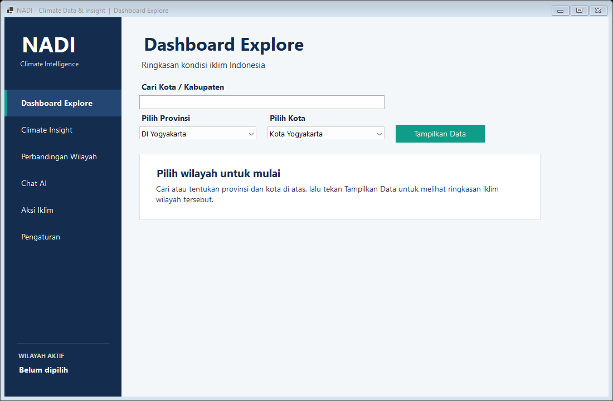
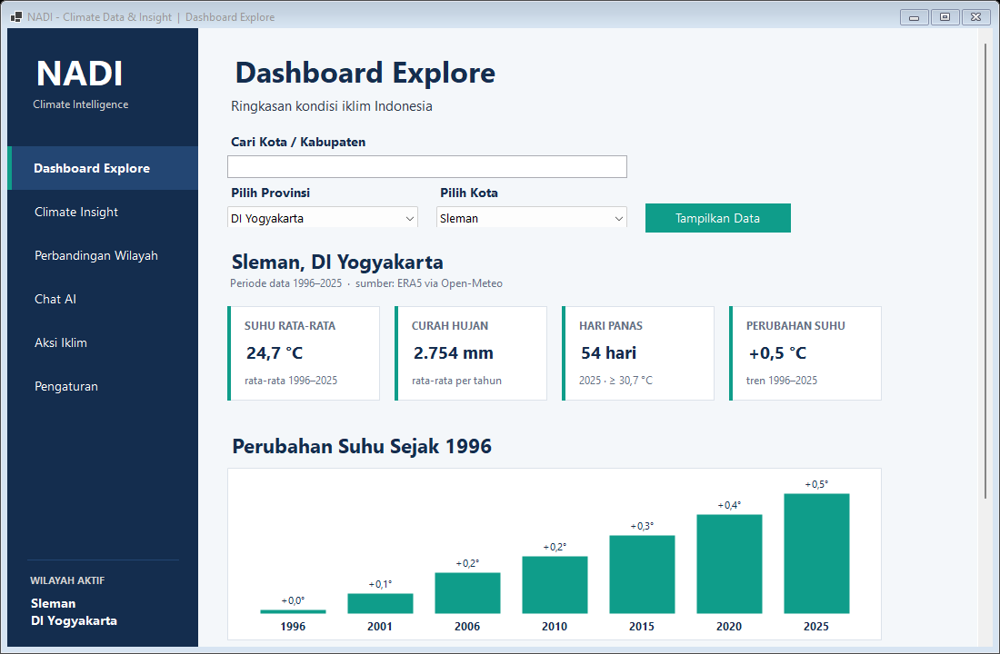
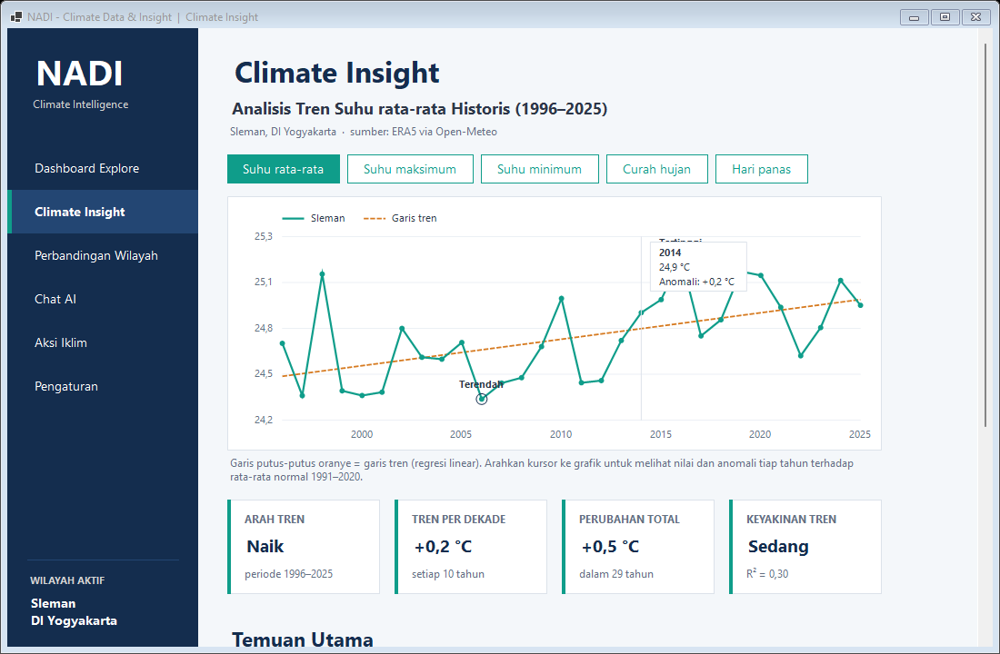
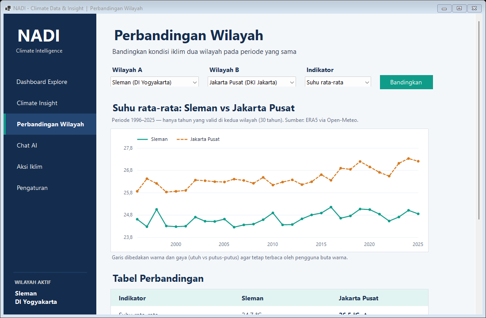
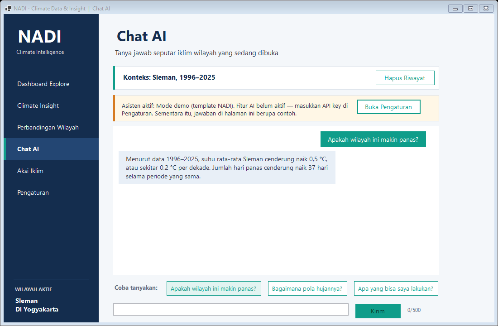
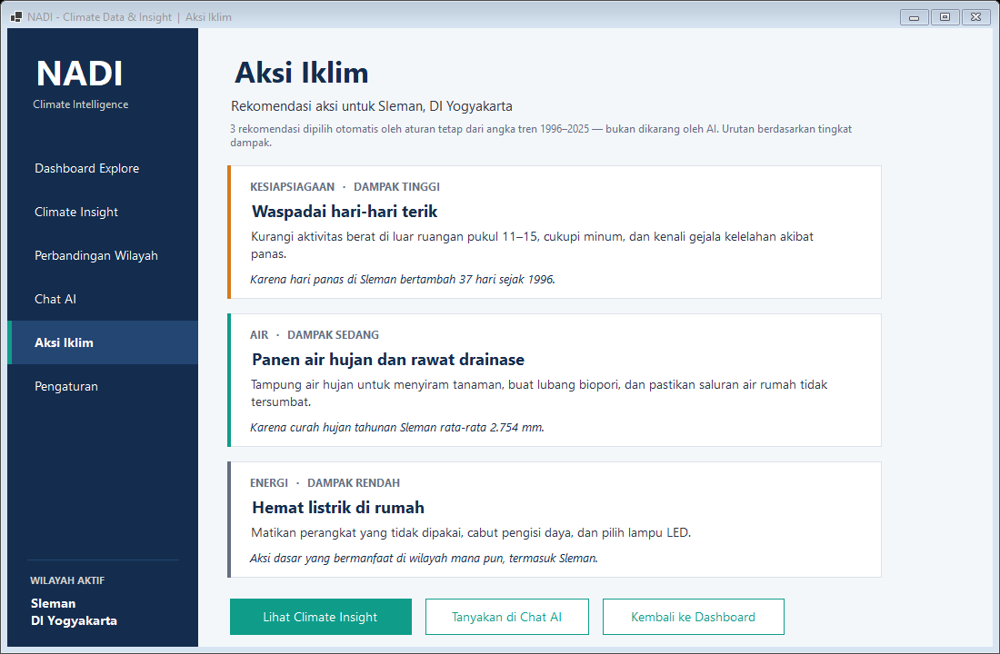
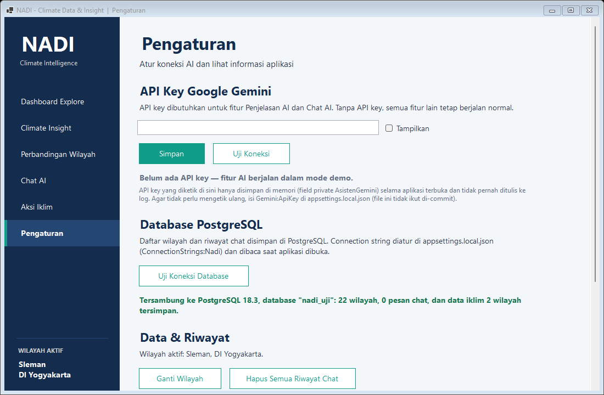
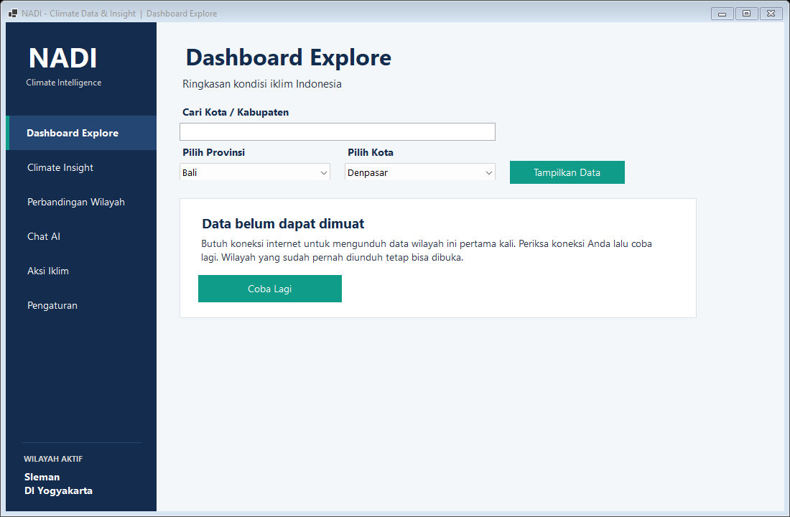

# Panduan Penggunaan NADI

**NADI (Nusantara Climate Data & Insight)** adalah aplikasi desktop Windows yang mengubah data iklim historis Indonesia menjadi grafik, penjelasan bahasa sehari-hari, dan rekomendasi aksi iklim. Alurnya: **Explore → Understand → Act**.

---

## 1. Persiapan (sekali saja)

### Kebutuhan

- Windows 10/11, 64-bit. **Tidak perlu memasang .NET** (sudah ada di dalam `NADI.exe`).
- Internet untuk mengunduh data iklim pertama kali tiap wilayah.
- PostgreSQL (opsional, disarankan). Tanpa PostgreSQL aplikasi tetap berjalan, tetapi data iklim dan riwayat chat hanya tersimpan selama aplikasi terbuka.

### Langkah instalasi

1. Ekstrak `NADI-v1.0.0-win-x64.zip` ke folder mana saja (misalnya `D:\NADI`).
2. **Bila memakai PostgreSQL:** klik ganda `siapkan-database.bat`, lalu isi password PostgreSQL Anda.
   Skrip ini otomatis membuat database `nadi`, membuat tabel dan 22 wilayah awal, serta menulis `appsettings.local.json` di folder yang sama.
3. Klik ganda `NADI.exe`.

> Pengguna yang ingin mengatur sendiri bisa menyalin `appsettings.example.json` menjadi `appsettings.local.json`, mengisi `ConnectionStrings:Nadi`, dan menjalankan `database\schema.sql` secara manual. Skemanya aman dijalankan ulang.

### Opsi `siapkan-database`

Jalankan lewat PowerShell bila server tidak standar:

```powershell
.\siapkan-database.ps1 -Server localhost -Port 5432 -Database nadi -User postgres
.\siapkan-database.ps1 -Timpa     # menulis ulang appsettings.local.json yang sudah ada
```

---

## 2. Cara memakai

Menu ada di sidebar kiri. Bagian **WILAYAH AKTIF** di dasar sidebar selalu menunjukkan wilayah yang sedang dipakai di semua halaman.

### 2.1 Dashboard Explore: memilih wilayah



1. Ketik nama kota di **Cari Kota / Kabupaten**; daftar saran muncul otomatis. Atau pilih **Provinsi** lalu **Kota** secara manual.
2. Tekan **Tampilkan Data**.
   - Pertama kali untuk satu wilayah, NADI mengunduh data harian dari Open-Meteo (sekitar 2–5 detik) dan menyimpannya.
   - Sesudahnya wilayah itu terbuka seketika, bahkan tanpa internet.



Yang ditampilkan:

| Kartu | Arti |
|---|---|
| **Suhu rata-rata** | Rata-rata suhu tahunan pada periode 30 tahun terakhir |
| **Curah hujan** | Rata-rata curah hujan per tahun |
| **Hari panas** | Jumlah hari tahun terakhir yang suhu maksimumnya melewati ambang wilayah itu (angka ambang ditulis di kartu) |
| **Perubahan suhu** | Perubahan suhu menurut garis tren sepanjang periode |

Pilihan wilayah terakhir diingat dan dipulihkan saat aplikasi dibuka lagi.

### 2.2 Climate Insight: memahami tren



- Pilih indikator: **Suhu rata-rata, Suhu maksimum, Suhu minimum, Curah hujan, Hari panas**. Grafik berganti tanpa mengunduh ulang.
- **Garis oranye putus-putus** adalah garis tren. Arahkan kursor ke grafik untuk melihat nilai tiap tahun dan **anomali** terhadap rata-rata normal 1991–2020.
- Kartu **Arah tren, Tren per dekade, Perubahan total, Keyakinan tren** meringkas garis tren. Bila keyakinan **Lemah**, NADI menuliskan "tren belum jelas" dan tidak menyimpulkan dengan tegas.
- Tombol **Jelaskan data ini dengan AI** menyusun penjelasan dalam bahasa sehari-hari.

### 2.3 Perbandingan Wilayah



1. Pilih **Wilayah A**, **Wilayah B**, dan **Indikator**, lalu tekan **Bandingkan**.
2. Wilayah yang belum pernah dibuka diunduh dulu (ada indikator "Memuat…").
3. Hasil berupa grafik dua garis (dibedakan warna **dan** gaya garis) serta tabel; tanda **▲** menunjukkan nilai yang lebih tinggi.

Bila A dan B sama, tombol **Bandingkan** nonaktif dan muncul peringatan. Perbandingan hanya memakai tahun yang valid di **kedua** wilayah.

### 2.4 Chat AI



- Tanyakan apa saja tentang iklim wilayah aktif, atau pakai tiga pertanyaan saran.
- Maksimal **500 karakter** per pesan. Tekan **Enter** atau **Kirim**.
- Riwayat disimpan per wilayah (permanen bila PostgreSQL aktif). **Hapus Riwayat** menghapus percakapan wilayah itu setelah konfirmasi.
- Pertanyaan di luar topik iklim ditolak dengan sopan. Chat tidak memprediksi cuaca masa depan dan bukan peringatan dini bencana.

### 2.5 Aksi Iklim



Menampilkan 3–5 kartu rekomendasi. Rekomendasi dipilih oleh **aturan tetap** dari angka tren wilayah (bukan dikarang AI). Setiap kartu memuat kategori, tingkat dampak, dan **alasan berbasis angka** ("Karena hari panas di Sleman bertambah 37 hari sejak 1996").

### 2.6 Pengaturan



- **API Key Google Gemini** (opsional): untuk Penjelasan AI dan Chat AI yang memakai model sungguhan.
  1. Ambil key gratis di [Google AI Studio](https://aistudio.google.com/).
  2. Tempel di kotak, tekan **Uji Koneksi**, lalu **Simpan**.
  3. Agar tidak perlu mengetik ulang, isi `Gemini` → `ApiKey` di `appsettings.local.json`.
  - Tanpa key, aplikasi memakai **mode demo** (jawaban dari template; banner kuning menandainya).
  - Bila Gemini tidak bisa dihubungi, jawaban otomatis memakai mode demo dan ada catatan alasannya.
- **Database PostgreSQL**: tombol **Uji Koneksi Database** menampilkan status dan jumlah wilayah/data tersimpan.
- **Data & Riwayat**: ganti wilayah atau hapus semua riwayat chat.
- **Disclaimer**: baca sebelum memakai data untuk keperluan resmi.

---

## 3. Jika terjadi masalah

| Yang tampak | Penyebab | Yang dilakukan |
|---|---|---|
| "Butuh koneksi internet untuk mengunduh data wilayah ini pertama kali" | Tidak ada internet dan wilayah belum pernah diunduh | Sambungkan internet, tekan **Coba Lagi**. Wilayah yang sudah diunduh tetap bisa dibuka |
| "Batas permintaan data per menit/jam/hari ke Open-Meteo sudah tercapai" | Kuota gratis Open-Meteo habis | Tunggu sesuai pesan lalu **Coba Lagi**. Satu unduhan 30 tahun cukup berat bagi kuota |
| "Sumber data iklim (Open-Meteo) sedang tidak tersedia" | Gangguan di server sumber data | Coba lagi beberapa saat kemudian |
| Banner kuning "Fitur AI belum aktif" | API key belum diisi | Isi key di **Pengaturan** (opsional) |
| "Gagal tersambung ke PostgreSQL…" di Pengaturan | Password salah / layanan PostgreSQL mati / belum menjalankan skema | Jalankan lagi `siapkan-database.bat`. Aplikasi tetap bisa dipakai tanpa database |
| Muncul kotak "Terjadi kesalahan tak terduga, tetapi NADI tetap berjalan" | Kesalahan yang tidak diperkirakan | Ulangi tindakan. Detail teknis ada di `%LOCALAPPDATA%\NADI\logs\` |



---

## 4. Catatan penting

- **Sumber data:** reanalisis ERA5 melalui [Open-Meteo](https://open-meteo.com/), satu titik koordinat per kota/kabupaten. Periode analisis adalah 30 tahun kalender penuh terakhir, dengan baseline normal 1991–2020.
- **Tahun valid:** hanya tahun dengan minimal 330 hari data lengkap yang dihitung; tahun lain dikecualikan dan dicantumkan di layar.
- **Hari panas:** hari dengan suhu maksimum ≥ persentil ke-90 suhu maksimum harian wilayah itu pada 1991–2020.
- **Data pribadi:** `appsettings.local.json` memuat password dan API key. Jangan dibagikan.

> NADI adalah aplikasi edukasi. Data iklim bersumber dari reanalisis ERA5 melalui Open-Meteo dan dapat berbeda dari pengamatan stasiun cuaca resmi. Penjelasan naratif dihasilkan oleh model bahasa AI berdasarkan statistik yang dihitung aplikasi, dan dapat mengandung kekeliruan. NADI bukan sumber peringatan dini bencana. Untuk informasi cuaca dan peringatan resmi, rujuk BMKG.
