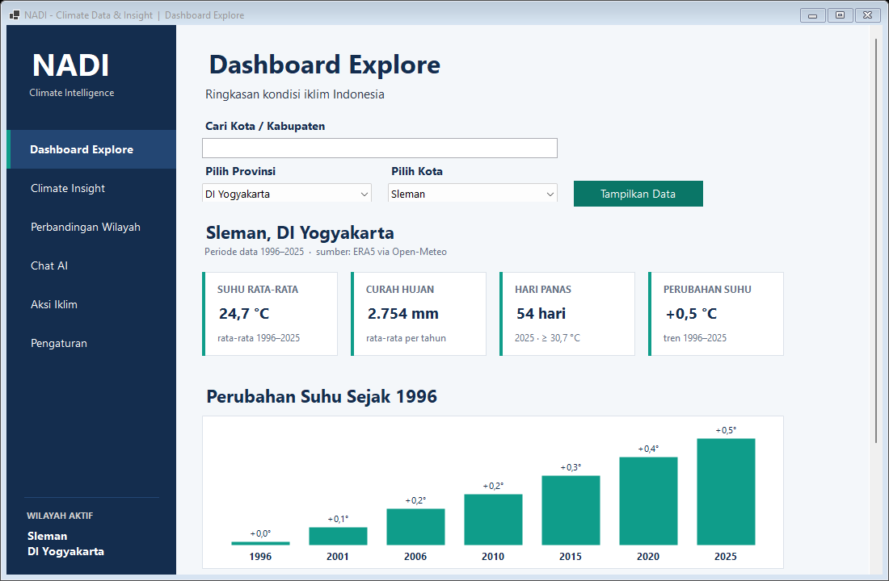
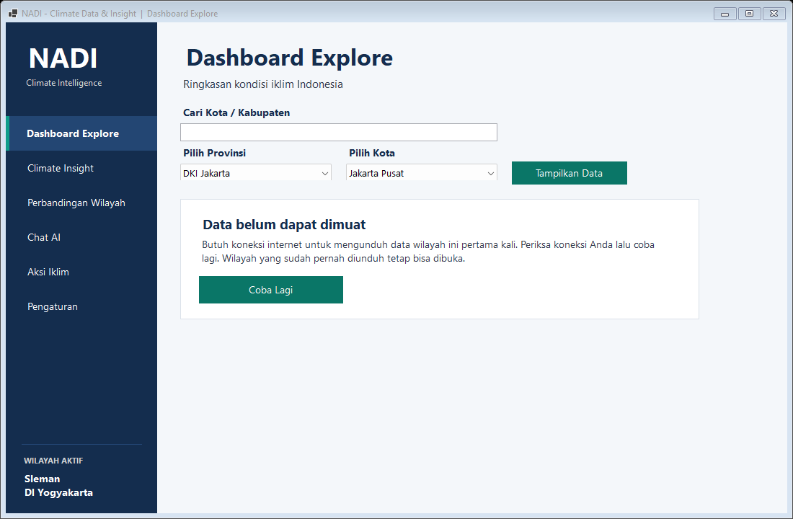
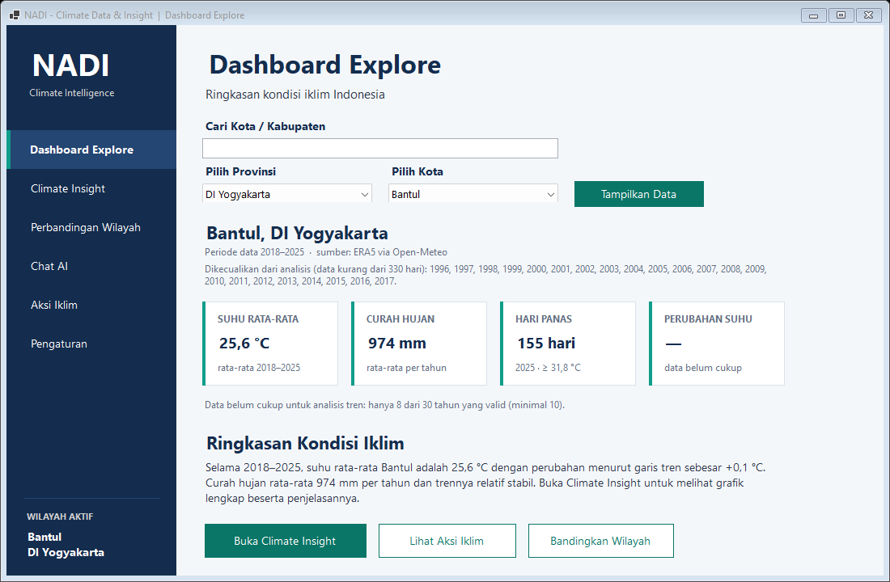
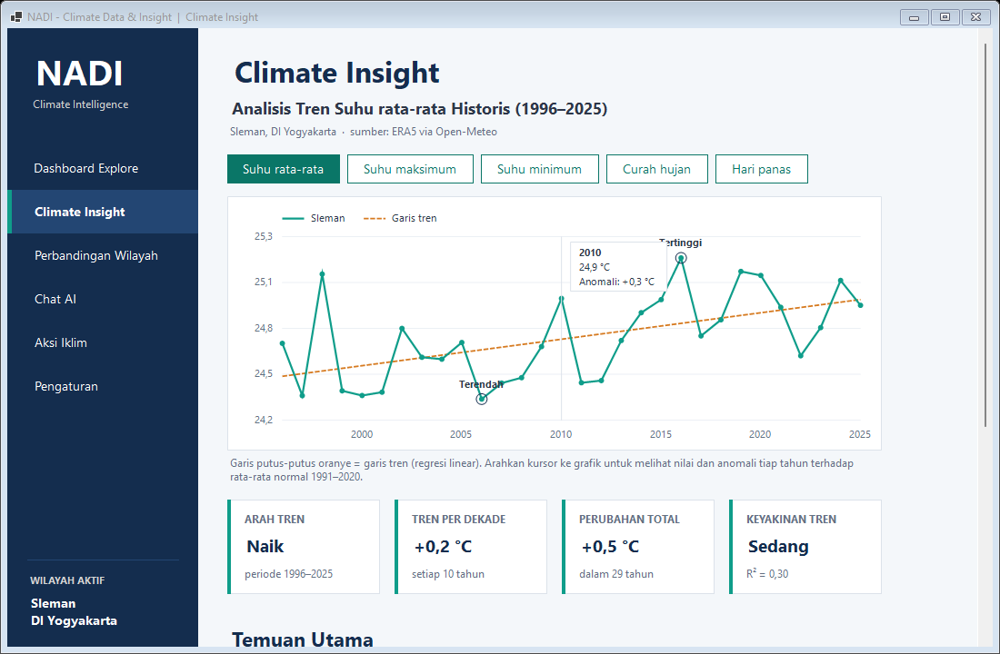
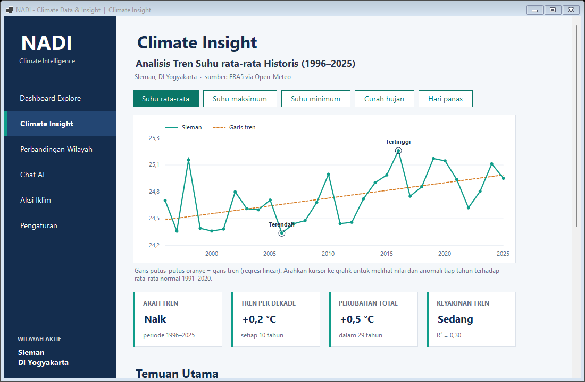
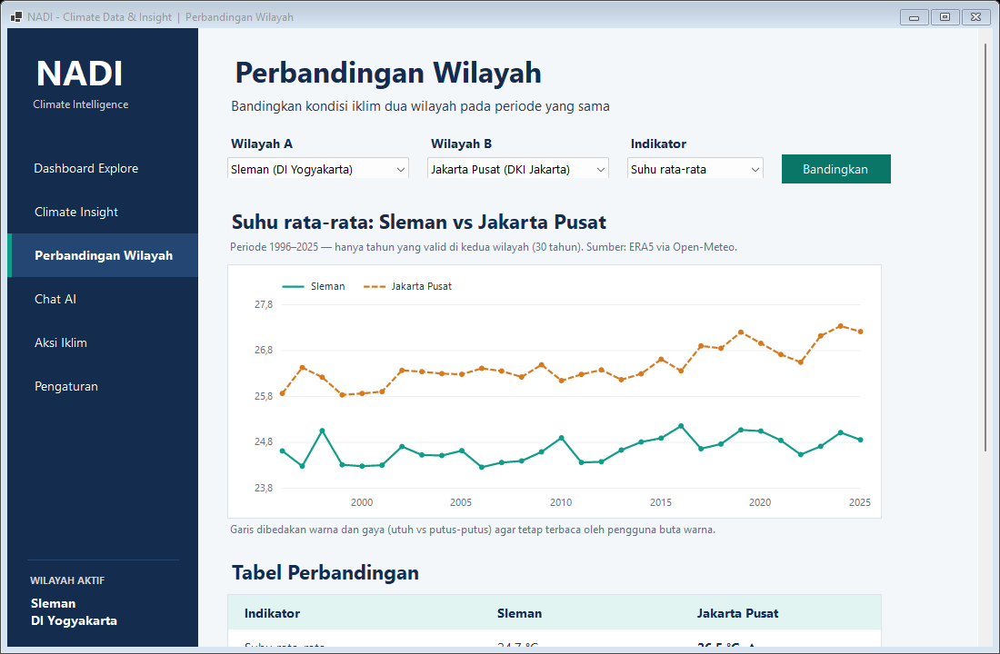
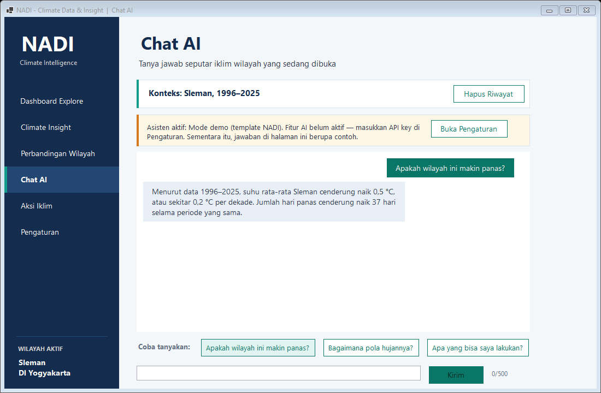
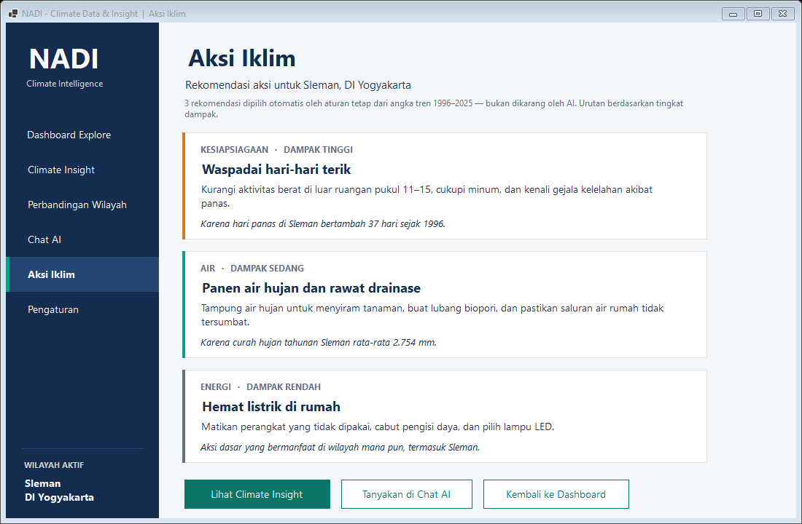
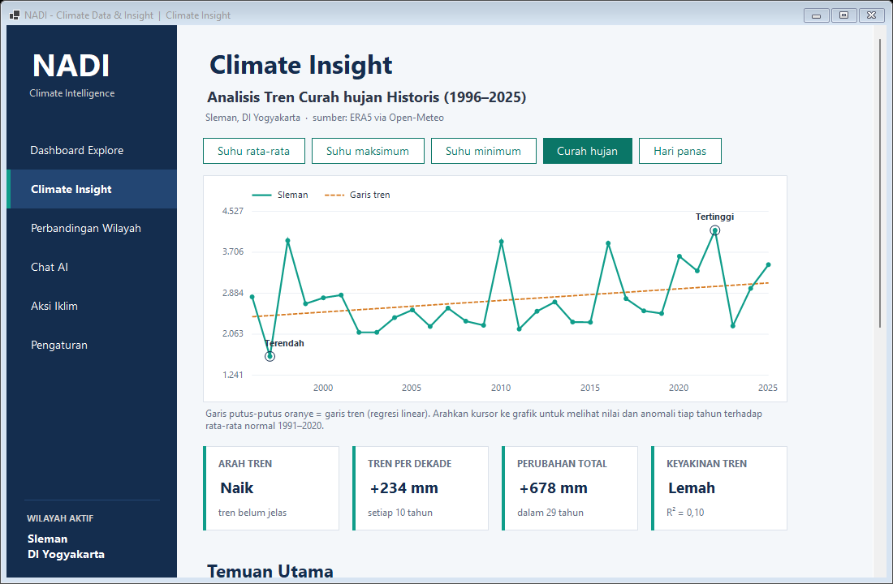
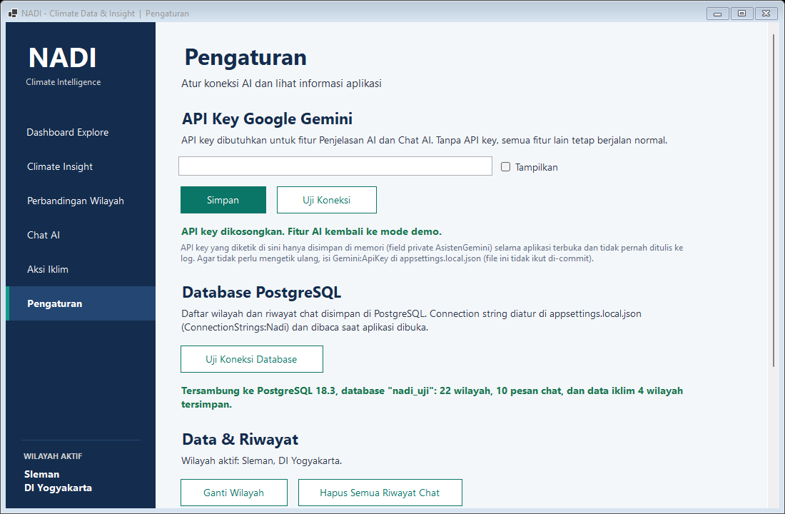

# Worksheet Black Box Testing: NADI

**Modul 10, Lab 10.2: Functional Testing (teknik Black Box)**

| | |
|---|---|
| **Nama Aplikasi** | NADI (Nusantara Climate Data & Insight) v1.0.0 |
| **Tanggal Pengujian** | 21 November 2026 |
| **Tester** | Razaqi Alkautsar (pengujian dijalankan lewat skrip yang menggerakkan aplikasi sungguhan, lihat "Cara pengujian") |
| **Versi kode** | branch `544958`, commit `5b59bff` |
| **Hasil ringkas** | **53 dari 53 kasus Sesuai** pada pengujian fungsional UI, ditambah 11 kasus paket dan skrip di bagian I |

## Cara pengujian

- Aplikasi dijalankan **utuh** (form asli, database PostgreSQL 18 yang bersih, API Open-Meteo yang sungguhan) dan digerakkan oleh skrip yang meniru klik dan ketikan pengguna, lalu membaca isi layar. Pernyataan "Sesuai" hanya diberikan bila isi layar yang teramati cocok dengan reaksi yang diharapkan.
- Gangguan yang sulit dibuat manual disimulasikan di lapisan jaringan: internet mati, kuota habis (HTTP 429), server error (HTTP 500), dan respons berformat salah. Kasus lainnya memakai jaringan dan database nyata. Kasus Gemini memakai API key palsu ke server Google sungguhan.
- Skrip penguji bukan bagian dari repo. Sebagai gantinya, logika yang sama dijaga oleh **117 unit test** (`dotnet test prototipe-ui/JunproProject.Tests`).
- Kolom **Reaksi Sistem (Salah)** menjelaskan perilaku yang dianggap gagal; kolom **Pengamatan** berisi apa yang benar-benar terlihat saat pengujian.

## Ringkasan per halaman

| Halaman | Kasus | Sesuai | Tidak Sesuai |
|---|---:|---:|---:|
| Umum dan navigasi | 4 | 4 | 0 |
| Start-up aplikasi (ketahanan) | 4 | 4 | 0 |
| Dashboard Explore | 13 | 13 | 0 |
| Climate Insight | 7 | 7 | 0 |
| Perbandingan Wilayah | 5 | 5 | 0 |
| Chat AI | 8 | 8 | 0 |
| Aksi Iklim | 3 | 3 | 0 |
| Pengaturan | 9 | 9 | 0 |
| **Total** | **53** | **53** | **0** |

## A. Umum dan navigasi

| No | Halaman yang Diuji | Aksi Aktor | Reaksi Sistem (Benar) | Reaksi Sistem (Salah) | Hasil | Pengamatan |
|---|---|---|---|---|---|---|
| N-01 | Umum | Membuka aplikasi | Dashboard Explore terbuka sebagai satu-satunya jendela; judul jendela memuat nama halaman | Aplikasi tidak terbuka / lebih dari satu jendela muncul | ☑ Sesuai ☐ Tidak Sesuai | judul='NADI - Climate Data & Insight  \|  Dashboard Explore', jendela terlihat=1 |
| N-02 | Umum | Mengklik keenam menu sidebar satu per satu | Setiap klik membuka form yang sesuai, form lain tersembunyi (satu jendela terlihat), judul jendela berubah | Salah halaman / dua jendela terlihat | ☑ Sesuai ☐ Tidak Sesuai | Climate Insight✓ Perbandingan Wilayah✓ Chat AI✓ Aksi Iklim✓ Pengaturan✓ Dashboard Explore✓ |
| N-03 | Umum | Memperhatikan menu pada tiap halaman | Menu halaman yang sedang dibuka disorot (warna aktif), menu lain tidak | Sorotan salah | ☑ Sesuai ☐ Tidak Sesuai | tepat satu menu disorot, sesuai halaman |
| N-04 | Umum | Memilih wilayah lalu berpindah ke semua halaman | Panel WILAYAH AKTIF di sidebar menampilkan "Sleman" di setiap halaman | Wilayah aktif tidak tampil atau tidak konsisten antar halaman | ☑ Sesuai ☐ Tidak Sesuai | Dashboard Explore:Sleman, Climate Insight:Sleman, Perbandingan Wilayah:Sleman, Chat AI:Sleman, Aksi Iklim:Sleman, Pengaturan:Sleman |

## B. Start-up aplikasi (ketahanan)

| No | Halaman yang Diuji | Aksi Aktor | Reaksi Sistem (Benar) | Reaksi Sistem (Salah) | Hasil | Pengamatan |
|---|---|---|---|---|---|---|
| R-01 | Start-up aplikasi | Membuka aplikasi tanpa file appsettings.local.json | Aplikasi tetap berjalan memakai daftar wilayah bawaan; status menjelaskan connection string belum diatur | Aplikasi crash saat start | ☑ Sesuai ☐ Tidak Sesuai | 22 wilayah bawaan; status: Connection string belum diatur di appsettings.local.json. Aplikasi mem… |
| R-02 | Start-up aplikasi | Membuka aplikasi dengan appsettings.local.json yang rusak (bukan JSON) | Aplikasi tetap berjalan; status menyebut gagal tersambung | Aplikasi crash saat start | ☑ Sesuai ☐ Tidak Sesuai | 22 wilayah bawaan; status: Gagal tersambung ke PostgreSQL ('i' is an invalid start of a value. LineNumber: … |
| R-03 | Start-up aplikasi | Membuka aplikasi saat server PostgreSQL tidak aktif / port salah | Aplikasi tetap berjalan tanpa database; status menyebut gagal tersambung | Aplikasi crash saat start | ☑ Sesuai ☐ Tidak Sesuai | 22 wilayah bawaan; status: Gagal tersambung ke PostgreSQL (Failed to connect to 127.0.0.1:5999). Aplikasi m… |
| R-04 | Start-up aplikasi | Membuka aplikasi dengan database yang skemanya belum dijalankan (tabel wilayah tidak ada) | Aplikasi tetap berjalan; status menyebut gagal tersambung | Aplikasi crash saat start | ☑ Sesuai ☐ Tidak Sesuai | 22 wilayah bawaan; status: Gagal tersambung ke PostgreSQL (42P01: relation "wilayah" does not exist    POSITION: 49). Aplikasi … |

## C. Dashboard Explore

| No | Halaman yang Diuji | Aksi Aktor | Reaksi Sistem (Benar) | Reaksi Sistem (Salah) | Hasil | Pengamatan |
|---|---|---|---|---|---|---|
| D-01 | Dashboard Explore | Melihat halaman sebelum memilih wilayah | Tampil keadaan kosong "Pilih wilayah untuk mulai"; WILAYAH AKTIF = "Belum dipilih"; bukan kartu kosong atau angka 0 | Kartu kosong atau angka 0 ditampilkan | ☑ Sesuai ☐ Tidak Sesuai | empty state tampil, tidak ada kartu KPI |
| D-02 | Dashboard Explore | Mengetik "sleman" di kotak Cari Kota / Kabupaten | Dropdown Provinsi otomatis "DI Yogyakarta" dan Kota "Sleman"; daftar saran autocomplete berisi seluruh kota | Dropdown tidak berubah | ☑ Sesuai ☐ Tidak Sesuai | provinsi='DI Yogyakarta', kota='Sleman', saran=22 |
| D-03 | Dashboard Explore | Mengetik nama yang tidak ada ("xyzkota") | Pilihan dropdown tidak berubah dan tidak terjadi error | Dropdown berubah/kosong atau muncul error | ☑ Sesuai ☐ Tidak Sesuai | tetap 'Sleman, DI Yogyakarta' |
| D-04 | Dashboard Explore | Memilih provinsi "Jawa Barat" | Dropdown Kota hanya berisi kota di provinsi itu (Bandung, Bogor, Bekasi) | Daftar kota tidak berganti / berisi kota provinsi lain | ☑ Sesuai ☐ Tidak Sesuai | kota: Bandung, Bekasi, Bogor |
| D-05 | Dashboard Explore | Memilih Sleman lalu menekan Tampilkan Data (pertama kali, database kosong) | Muncul "Memuat data iklim…" dan tombol nonaktif; selesai ≤ 15 detik dengan 4 kartu KPI, grafik batang, periode 1996–2025 dan sumber ERA5/Open-Meteo | Aplikasi membeku, tanpa indikator loading, atau data tidak tampil | ☑ Sesuai ☐ Tidak Sesuai | loading terlihat=True, selesai=9929 ms, 4 kartu=True, grafik=True, periode+sumber=True |
| D-06 | Dashboard Explore | Memilih ulang Sleman setelah aplikasi dibuka kembali, tanpa internet | Dashboard tampil ≤ 3 detik dari database lokal tanpa panggilan jaringan | Menunggu/gagal karena butuh internet | ☑ Sesuai ☐ Tidak Sesuai | tampil dalam 867 ms, panggilan jaringan=0 |
| D-07 | Dashboard Explore | Memilih wilayah yang belum pernah diunduh (Jakarta Pusat) saat tidak ada internet | Pesan "Butuh koneksi internet untuk mengunduh data wilayah ini pertama kali" dengan tombol Coba Lagi; aplikasi tidak crash | Aplikasi crash / menampilkan stack trace / pesan tidak jelas | ☑ Sesuai ☐ Tidak Sesuai | pesan koneksi + tombol Coba Lagi tampil |
| D-08 | Dashboard Explore | Menekan Coba Lagi setelah internet kembali | Data Jakarta Pusat diunduh dan dashboard tampil dengan kartu KPI | Tetap error / tombol tidak merespons | ☑ Sesuai ☐ Tidak Sesuai | dashboard Jakarta Pusat tampil setelah Coba Lagi |
| D-09 | Dashboard Explore | Server data iklim mengembalikan kuota habis (HTTP 429) | Pesan "Batas permintaan data per menit … sudah tercapai" + Coba Lagi, tanpa retry yang sia-sia | Loading tanpa akhir atau pesan umum yang membingungkan | ☑ Sesuai ☐ Tidak Sesuai | pesan kuota tampil; panggilan=1 (tidak diulang) |
| D-10 | Dashboard Explore | Server data iklim error (HTTP 500) | Pesan "Sumber data iklim (Open-Meteo) sedang tidak tersedia" dan Coba Lagi | Aplikasi crash atau pesan teknis | ☑ Sesuai ☐ Tidak Sesuai | pesan tampil; percobaan=3 (1 + 2 retry) |
| D-11 | Dashboard Explore | Server mengirim data berformat salah | Pesan "Data dari sumber iklim tidak sesuai format"; data tidak ditampilkan dan tidak disimpan | Data parsial tampil/tersimpan atau crash | ☑ Sesuai ☐ Tidak Sesuai | pesan format tampil; data tersimpan di memori=False |
| D-12 | Dashboard Explore | Wilayah (Bantul) yang datanya hanya valid untuk 8 dari 30 tahun (baseline 1991–2020 tersedia) | Kartu Perubahan Suhu "—" + "data belum cukup"; grafik tren disembunyikan dengan catatan alasannya | Garis tren tetap digambar dari data yang tidak memadai | ☑ Sesuai ☐ Tidak Sesuai | kartu '—' + catatan; tanpa grafik tren |
| D-13 | Dashboard Explore | Menekan tombol Buka Climate Insight, Lihat Aksi Iklim, dan Bandingkan Wilayah | Masing-masing membuka form tujuan dan menyembunyikan Dashboard | Tombol tidak merespons / form salah terbuka | ☑ Sesuai ☐ Tidak Sesuai | Buka Climate Insight->InsightForm; Lihat Aksi Iklim->AksiForm; Bandingkan Wilayah->PerbandinganForm |

**D-05:** Dashboard setelah unduhan pertama Sleman

**D-07:** Pesan tanpa internet dengan tombol Coba Lagi

**D-12:** Data kurang dari 10 tahun valid: tren disembunyikan

## D. Climate Insight

| No | Halaman yang Diuji | Aksi Aktor | Reaksi Sistem (Benar) | Reaksi Sistem (Salah) | Hasil | Pengamatan |
|---|---|---|---|---|---|---|
| I-01 | Climate Insight | Membuka menu sebelum memilih wilayah | Keadaan kosong "Belum ada wilayah yang dipilih" dengan tombol Pilih Wilayah; tombol itu membawa ke Dashboard | Halaman kosong/error, atau tombol tidak berfungsi | ☑ Sesuai ☐ Tidak Sesuai | empty state=True; setelah klik Pilih Wilayah -> Dashboard terlihat=True |
| I-02 | Climate Insight | Membuka halaman setelah wilayah dipilih | Tampil grafik garis + garis tren, 4 kartu tren (arah, per dekade, total, keyakinan), dan Temuan Utama | Grafik/kartu tidak muncul | ☑ Sesuai ☐ Tidak Sesuai | grafik garis, 4 kartu tren, Temuan Utama tampil |
| I-03 | Climate Insight | Mengganti indikator satu per satu (5 pilihan) | Judul dan grafik berganti sesuai indikator tanpa mengunduh ulang data (0 panggilan jaringan) | Grafik tidak berubah atau memicu unduhan ulang | ☑ Sesuai ☐ Tidak Sesuai | Suhu maksimum✓ Suhu minimum✓ Curah hujan✓ Hari panas✓ Suhu rata-rata✓; panggilan jaringan +0 |
| I-04 | Climate Insight | Mengarahkan kursor ke grafik | Garis pemandu dan tooltip menampilkan tahun, nilai, dan anomali terhadap baseline 1991–2020 | Tidak ada tooltip | ☑ Sesuai ☐ Tidak Sesuai | tooltip aktif pada indeks tahun ke-14 |
| I-05 | Climate Insight | Pilih Hari panas | Muncul catatan ambang hari panas (persentil ke-90 suhu maksimum 1991–2020) | Ambang tidak dijelaskan | ☑ Sesuai ☐ Tidak Sesuai | catatan ambang tampil |
| I-06 | Climate Insight | Menekan Jelaskan data ini dengan AI (mode demo) | Tombol nonaktif "Menyusun penjelasan…" selama menunggu; lalu penjelasan + label "Penjelasan dibuat AI berdasarkan angka yang dihitung aplikasi" | Tombol bisa ditekan berulang / tidak ada hasil | ☑ Sesuai ☐ Tidak Sesuai | tombol nonaktif saat menunggu=True, hasil tampil=True, permintaan +1 |
| I-07 | Climate Insight | Berganti indikator lalu kembali ke indikator yang sudah dijelaskan | Penjelasan langsung tampil dari cache tanpa memanggil AI lagi | AI dipanggil ulang | ☑ Sesuai ☐ Tidak Sesuai | penjelasan tampil langsung; permintaan AI +0 |

**I-04:** Tooltip tahun, nilai, dan anomali

**I-06:** Penjelasan AI mode demo

## E. Perbandingan Wilayah

| No | Halaman yang Diuji | Aksi Aktor | Reaksi Sistem (Benar) | Reaksi Sistem (Salah) | Hasil | Pengamatan |
|---|---|---|---|---|---|---|
| P-01 | Perbandingan Wilayah | Membuka menu sebelum ada data dimuat | Muncul ajakan "Pilih dua wilayah untuk dibandingkan" dan tidak mengunduh apa pun otomatis | Data terunduh otomatis tanpa aksi pengguna, atau halaman error | ☑ Sesuai ☐ Tidak Sesuai | ajakan tampil; panggilan jaringan bertambah 0 |
| P-02 | Perbandingan Wilayah | Memilih wilayah A sama dengan wilayah B | Tombol Bandingkan nonaktif dan muncul peringatan "Pilih dua wilayah yang berbeda" | Tombol tetap aktif / tidak ada peringatan | ☑ Sesuai ☐ Tidak Sesuai | Bandingkan nonaktif + peringatan tampil |
| P-03 | Perbandingan Wilayah | Memilih Sleman vs Jakarta Pusat lalu Bandingkan | Grafik dua deret dengan legenda dan gaya garis berbeda + tabel 6 indikator dengan tanda ▲ pada nilai lebih tinggi; periode hanya tahun valid di kedua wilayah | Hanya satu deret / tabel kosong | ☑ Sesuai ☐ Tidak Sesuai | grafik=True, tabel 7 baris=True, ▲=True, keterangan periode=True |
| P-04 | Perbandingan Wilayah | Mengganti indikator ke Curah hujan lalu Bandingkan | Judul dan grafik berganti menjadi "Curah hujan: Sleman vs Jakarta Pusat" | Grafik tetap suhu | ☑ Sesuai ☐ Tidak Sesuai | judul berganti |
| P-05 | Perbandingan Wilayah | Memilih wilayah B yang belum diunduh (Bandung) lalu Bandingkan | Muncul "Memuat data kedua wilayah…" tanpa membekukan aplikasi; setelah selesai hasil tampil | Aplikasi membeku / error tanpa pesan | ☑ Sesuai ☐ Tidak Sesuai | loading tampil=True, hasil tampil=True |

**P-03:** Perbandingan Sleman vs Jakarta Pusat

## F. Chat AI

| No | Halaman yang Diuji | Aksi Aktor | Reaksi Sistem (Benar) | Reaksi Sistem (Salah) | Hasil | Pengamatan |
|---|---|---|---|---|---|---|
| C-01 | Chat AI | Membuka menu sebelum memilih wilayah | Keadaan kosong dengan tombol menuju Dashboard | Halaman kosong/error | ☑ Sesuai ☐ Tidak Sesuai | empty state tampil |
| C-02 | Chat AI | Menekan pertanyaan saran "Apakah wilayah ini makin panas?" | Pesan pengguna tampil di kanan; jawaban merujuk angka tren Sleman yang sama dengan grafik | Tidak ada jawaban / angka berbeda dari grafik | ☑ Sesuai ☐ Tidak Sesuai | jawaban memuat '0,5 °C' (angka tren grafik): True |
| C-03 | Chat AI | Mengirim pesan kosong / hanya spasi | Tombol Kirim nonaktif | Pesan kosong terkirim | ☑ Sesuai ☐ Tidak Sesuai | Kirim nonaktif |
| C-04 | Chat AI | Bertanya di luar topik: "Siapa presiden Indonesia?" | Ditolak dengan sopan dan diarahkan kembali ke topik iklim | AI menjawab di luar topik | ☑ Sesuai ☐ Tidak Sesuai | Maaf, aku hanya bisa membahas iklim, cuaca, lingkungan, dan aksi iklim. Mau tahu tren suhu atau pola hujan di Sleman? |
| C-05 | Chat AI | Bertanya tentang wilayah yang datanya tidak dimuat: "Bagaimana dengan Denpasar?" | Menyatakan data belum dimuat dan menyarankan memilihnya di Dashboard; tidak mengarang angka | Menyebut angka karangan | ☑ Sesuai ☐ Tidak Sesuai | Maaf, data Denpasar belum dimuat di percakapan ini, jadi aku tidak bisa menyebut angkanya. Pilih Denpasar lewat menu Dashboard Explore, lalu tanyakan lagi di sini ya. |
| C-06 | Chat AI | Meminta prediksi ("Bagaimana suhu tahun depan?") dan bertanya soal banjir | Menolak memprediksi; untuk bencana diarahkan ke BMKG | Memberi prediksi / peringatan bencana | ☑ Sesuai ☐ Tidak Sesuai | prediksi: 'NADI hanya menjelaskan data Sleman periode 1996–2025 yang sudah terjad…' \| banjir: 'NADI bukan sumber peringatan dini bencana. Untuk informasi dan peringa…' |
| C-07 | Chat AI | Memeriksa batas panjang pesan | Kolom pesan membatasi 500 karakter dan penghitung "n/500" tampil | Pesan lebih dari 500 karakter diterima | ☑ Sesuai ☐ Tidak Sesuai | MaxLength=500 |
| C-08 | Chat AI | Berpindah halaman lalu kembali ke Chat AI; membaca riwayat di database | Riwayat percakapan wilayah itu tetap tampil dan tersimpan permanen di PostgreSQL | Riwayat hilang | ☑ Sesuai ☐ Tidak Sesuai | 10 pesan; gelembung tampil=10; tersimpan di PostgreSQL=10 |

**C-02:** Percakapan Chat AI

## G. Aksi Iklim

| No | Halaman yang Diuji | Aksi Aktor | Reaksi Sistem (Benar) | Reaksi Sistem (Salah) | Hasil | Pengamatan |
|---|---|---|---|---|---|---|
| A-01 | Aksi Iklim | Membuka menu sebelum memilih wilayah | Keadaan kosong dengan tombol menuju Dashboard | Halaman kosong/error | ☑ Sesuai ☐ Tidak Sesuai | empty state tampil |
| A-02 | Aksi Iklim | Membuka halaman setelah wilayah dipilih | Tampil 3–5 kartu; tiap kartu memuat kategori, tingkat dampak, dan alasan berbasis angka wilayah | Kurang dari 3 kartu / kartu tanpa alasan | ☑ Sesuai ☐ Tidak Sesuai | 3 kartu tampil; semua beralasan, kartu spesifik beralasan angka=True |
| A-03 | Aksi Iklim | Membuka halaman berulang kali untuk wilayah yang sama | Daftar rekomendasi identik setiap kali (deterministik) | Urutan/isi berubah-ubah | ☑ Sesuai ☐ Tidak Sesuai | dua pemanggilan menghasilkan daftar yang sama |

**A-02:** Kartu rekomendasi aksi

## H. Pengaturan

| No | Halaman yang Diuji | Aksi Aktor | Reaksi Sistem (Benar) | Reaksi Sistem (Salah) | Hasil | Pengamatan |
|---|---|---|---|---|---|---|
| S-01 | Pengaturan | Menekan Uji Koneksi dengan API key kosong | Pesan "Fitur AI belum aktif — masukkan API key" | Error / crash | ☑ Sesuai ☐ Tidak Sesuai | pesan tampil |
| S-02 | Pengaturan | Mengisi API key berformat salah ("abc") lalu Uji Koneksi | Pesan "Format API key tampaknya tidak valid" | Dianggap valid | ☑ Sesuai ☐ Tidak Sesuai | pesan tampil |
| S-03 | Pengaturan | Mengisi API key palsu berformat wajar lalu Uji Koneksi (menghubungi Gemini sungguhan) | Setelah menghubungi Gemini muncul "Koneksi ke Gemini gagal: API key ditolak" | Dianggap berhasil / crash | ☑ Sesuai ☐ Tidak Sesuai | Koneksi ke Gemini gagal: API key ditolak oleh Gemini — periksa kembali key dari Google AI Studio. |
| S-04 | Pengaturan | Menyimpan API key palsu lalu membuka Climate Insight dan menjelaskan data (Gemini menolak key) | Banner "Asisten aktif: Google Gemini"; karena ditolak, jawaban memakai mode demo dengan catatan "Gemini tidak dapat dipakai"; aplikasi tidak crash | Crash / tidak ada jawaban sama sekali | ☑ Sesuai ☐ Tidak Sesuai | asisten=Gemini True, banner=True, jawaban cadangan+catatan=True |
| S-05 | Pengaturan | Mengosongkan API key lalu Simpan | Asisten kembali ke mode demo | Tetap memakai Gemini | ☑ Sesuai ☐ Tidak Sesuai | asisten=Mode demo |
| S-06 | Pengaturan | Menekan Uji Koneksi Database | Status hijau: "Tersambung ke PostgreSQL" beserta jumlah wilayah, pesan chat, dan data iklim tersimpan | Error / crash | ☑ Sesuai ☐ Tidak Sesuai | Tersambung ke PostgreSQL 18.3, database "nadi_uji": 22 wilayah, 10 pesan chat, dan data iklim 4 wilayah tersimpan. |
| S-07 | Pengaturan | Mencentang Tampilkan pada kolom API key | Karakter key terlihat; saat dicentang ulang kembali disamarkan | Key tidak bisa ditampilkan | ☑ Sesuai ☐ Tidak Sesuai | disamarkan=True, saat dicentang terlihat=True, kembali disamarkan=True |
| S-08 | Pengaturan | Membaca bagian Tentang NADI | Disclaimer produk tampil lengkap (data ERA5, AI dapat keliru, bukan peringatan dini bencana, rujuk BMKG) | Disclaimer tidak ada | ☑ Sesuai ☐ Tidak Sesuai | disclaimer lengkap tampil |
| S-09 | Pengaturan | Menekan Ganti Wilayah | Berpindah ke Dashboard Explore | Tombol tidak berfungsi | ☑ Sesuai ☐ Tidak Sesuai | Dashboard terbuka |

**S-04:** Gemini menolak key, jawaban cadangan mode demo

**S-06:** Uji koneksi database

## I. Paket `.exe` dan skrip penyiapan database

Diuji dari folder bersih hasil ekstrak `NADI-v1.0.0-win-x64.zip` (44,8 MB). Pada komputer pengembang tetap terpasang .NET dan PostgreSQL; pengujian pada komputer yang benar-benar bersih ada di bagian J.

| No | Halaman yang Diuji | Aksi Aktor | Reaksi Sistem (Benar) | Reaksi Sistem (Salah) | Hasil | Pengamatan |
|---|---|---|---|---|---|---|
| PK-01 | Paket NADI.exe | Mengekstrak zip lalu membuka NADI.exe tanpa konfigurasi | Aplikasi terbuka di Dashboard Explore tanpa memasang apa pun | Gagal terbuka / meminta .NET | ☑ Sesuai ☐ Tidak Sesuai | hidup, judul 'NADI - Climate Data & Insight \| Dashboard Explore', memori 132 MB; ukuran NADI.exe 49,9 MB |
| PK-02 | Paket NADI.exe | Memeriksa isi zip | Tidak memuat appsettings.local.json milik pengembang (password/API key) | Rahasia lokal ikut terbawa | ☑ Sesuai ☐ Tidak Sesuai | isi: NADI.exe, siapkan-database.bat/.ps1, appsettings.example.json, BACA-DULU.txt, PANDUAN.md, database/schema.sql, screenshots/; tanpa appsettings.local.json |
| PK-03 | Paket NADI.exe | Menutup jendela aplikasi | Proses berhenti penuh | Proses tertinggal di Task Manager | ☑ Sesuai ☐ Tidak Sesuai | berhenti dalam 544 ms; sisa proses NADI = 0 |
| PK-04 | Paket NADI.exe | Membuka aplikasi dengan appsettings.local.json yang rusak | Aplikasi tetap terbuka (tanpa database) | Crash saat start | ☑ Sesuai ☐ Tidak Sesuai | hidup, tidak ada log error |
| PS-01 | siapkan-database | Menjalankan skrip ke server yang tidak aktif (port salah) | Pesan ramah "GAGAL: Tidak bisa terhubung ke PostgreSQL" beserta saran, exit code 1 | Jejak error mentah PowerShell | ☑ Sesuai ☐ Tidak Sesuai | pesan ramah tampil, exit code 1 (cacat awal jejak mentah sudah diperbaiki dan diuji ulang) |
| PS-02 | siapkan-database | Menjalankan skrip dengan nama database berisi karakter berbahaya (nama;drop) | Ditolak oleh validasi parameter | Perintah SQL dieksekusi | ☑ Sesuai ☐ Tidak Sesuai | ditolak: argumen tidak cocok pola ^[A-Za-z_][A-Za-z0-9_]*$ |
| PS-03 | siapkan-database | Menjalankan skrip normal dengan password berisi ; = spasi dan kutip | Database dibuat, 22 wilayah tersedia, appsettings.local.json ditulis dengan password terkutip benar | Konfigurasi rusak / gagal | ☑ Sesuai ☐ Tidak Sesuai | database dibuat, 22 wilayah, tabel: data_iklim_harian, pesan_chat, wilayah; exit code 0 |
| PS-04 | siapkan-database | Menjalankan skrip kedua kali tanpa -Timpa | Idempotent; appsettings.local.json tidak berubah | Konfigurasi tertimpa / error | ☑ Sesuai ☐ Tidak Sesuai | tabel siap lagi; hash berkas konfigurasi tidak berubah |
| PS-05 | siapkan-database | Menjalankan dengan -Timpa saat appsettings.local.json berisi API key | Connection string diperbarui, API key lama dipertahankan | API key hilang | ☑ Sesuai ☐ Tidak Sesuai | ApiKey sebelum dan sesudah -Timpa sama |
| PS-06 | NADI.exe + hasil siapkan-database | Membuka NADI.exe dari folder hasil penyiapan (password berisi ; = kutip) | Aplikasi membaca konfigurasi dan tersambung ke database | Tidak tersambung | ☑ Sesuai ☐ Tidak Sesuai | sesi ke database baru muncul saat aplikasi terbuka (0 menjadi 1) |
| PS-07 | siapkan-database | Membuat paket ulang dengan buat-paket.ps1 saat appsettings.local.json ada di root repo | Paket Release tidak membawa berkas rahasia itu | Rahasia terbawa di paket | ☑ Sesuai ☐ Tidak Sesuai | diuji dengan berkas pancingan (password dan API key palsu) di root repo: 0 salinan di folder dist dan 0 di dalam zip; teks pancingan tidak bocor ke berkas teks paket; git mengabaikan berkasnya |

## J. Belum diuji, perlu dicek manual oleh tester

Bagian ini sengaja dibiarkan kosong. Pengujian otomatis tidak dapat memastikannya, dan hasilnya tidak boleh diisi tanpa dicoba langsung.

| No | Halaman yang Diuji | Aksi Aktor | Reaksi Sistem (Benar) | Hasil |
|---|---|---|---|---|
| M-01 | Chat AI / Climate Insight | Mengisi API key Gemini **yang asli**, lalu menjelaskan data dan bertanya di chat | Jawaban berasal dari model, memakai hanya angka dari data (target PRD AC-04.2: 10 dari 10 wilayah tanpa angka karangan) | ☐ Sesuai ☐ Tidak Sesuai |
| M-02 | Chat AI | Menekan Hapus Riwayat lalu memilih Ya / Tidak pada dialog konfirmasi | Ya menghapus riwayat wilayah itu; Tidak membatalkan | ☐ Sesuai ☐ Tidak Sesuai |
| M-03 | Dashboard Explore | Memutus internet secara fisik (Wi-Fi mati) lalu memilih wilayah baru | Pesan "Butuh koneksi internet" tampil (sudah teruji lewat simulasi, belum lewat jaringan yang benar-benar putus) | ☐ Sesuai ☐ Tidak Sesuai |
| M-04 | Seluruh halaman | Membuka aplikasi pada layar skala 125% dan 150%, serta memperkecil jendela ke ukuran minimum | Teks dan tombol tidak terpotong, tidak ada scroll horizontal | ☐ Sesuai ☐ Tidak Sesuai |
| M-05 | Paket NADI.exe | Memasang di komputer lain yang belum punya .NET maupun PostgreSQL | NADI.exe terbuka; tanpa PostgreSQL aplikasi berjalan dengan data di memori | ☐ Sesuai ☐ Tidak Sesuai |
| M-06 | Paket NADI.exe | Menjalankan siapkan-database.bat dengan klik ganda di komputer lain yang punya PostgreSQL | Database dan konfigurasi tersiapkan | ☐ Sesuai ☐ Tidak Sesuai |
| M-07 | Seluruh halaman | Mencoba aplikasi bersama pengguna sasaran (mahasiswa atau guru IPA) selama 10 menit | Pengguna dapat menyelesaikan alur Explore, Understand, Act tanpa bantuan (validasi asumsi PRD §2) | ☐ Sesuai ☐ Tidak Sesuai |

## Catatan temuan selama pengujian

1. **Kontras warna (diperbaiki).** Teal bawaan `#0F9D8A` hanya 3,38:1 terhadap putih, di bawah syarat PRD 4,5:1. Komponen berteks (tombol, gelembung chat) kini memakai `#0A7667` (5,53:1); teal asli dipertahankan untuk elemen non-teks. Dijaga oleh test `KontrasWarnaTests`.
2. **Waktu unduhan pertama bervariasi.** Pada tiga kali pengujian D-05 hasilnya 4,1 dtk, 12,6 dtk, dan 9,9 dtk. Seluruhnya masih ≤ 15 dtk (PRD AC-01.1), tetapi bergantung pada jaringan dan kuota Open-Meteo.
3. **Kuota Open-Meteo.** Satu unduhan 30 tahun cukup berat bagi kuota gratis (HTTP 429 per menit/jam/hari). Aplikasi menampilkan pesan yang menjelaskan berapa lama menunggu dan tidak mengulang percobaan secara sia-sia (kasus D-09).
4. **Skenario D-12 diperbaiki.** Percobaan pertama memakai data yang tidak punya baseline 1991–2020, sehingga aplikasi menolaknya sebagai format salah (perilaku yang benar). Skenario diganti dengan data yang baseline-nya ada tetapi hanya 8 tahun valid, lalu lulus.
5. **Skrip penyiapan database (diperbaiki).** Pengujian PS-01 awalnya menampilkan jejak error mentah PowerShell, bukan pesan ramah. Diperbaiki dan diuji ulang.
